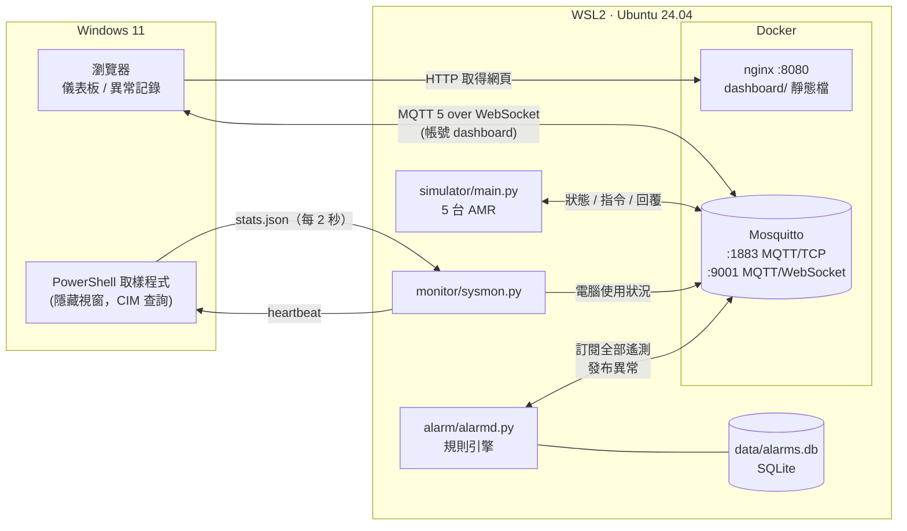

# AMR MQTT 監控系統（amr-mqtt-monitor）

一個在單台 Windows 電腦上就能完整運作的 **AMR（自主移動機器人）車隊監控** 練習專案：

- 模擬 5 台 AMR 在倉庫裡接任務、移動、充電、偶爾故障
- 即時顯示**這台 Windows 電腦本身**的 CPU / 記憶體 / 磁碟 / 網路 / 電池
- 自動**偵測異常**（斷線、故障、低電量、卡住、資源過高…），寫入資料庫並在網頁上警報
- 所有資料都透過 **MQTT 5** 傳遞，網頁直接以 WebSocket 訂閱，沒有額外的後端 API

| 頁面 | 網址 |
|---|---|
| 儀表板：倉庫地圖、車隊狀態、電腦使用狀況、Broker 狀態 | http://localhost:8080 |
| 異常記錄：篩選、確認、匯出 CSV | http://localhost:8080/alarms.html |

---

## 目錄

1. [使用技術](#1-使用技術)
2. [系統架構](#2-系統架構)
3. [目錄結構](#3-目錄結構)
4. [MQTT 設計](#4-mqtt-設計)
5. [異常偵測](#5-異常偵測)
6. [安全性](#6-安全性)
7. [第一次安裝](#7-第一次安裝)
8. [開啟](#8-開啟)
9. [測試](#9-測試)
10. [關閉](#10-關閉)
11. [日常維運](#11-日常維運)
12. [疑難排解](#12-疑難排解)
13. [已知限制](#13-已知限制)

---

## 1. 使用技術

| 分類 | 技術（實測版本） | 用途 |
|---|---|---|
| 作業系統 | Windows 11 + **WSL2**（3.0.3）+ **Ubuntu 24.04** | Linux 環境跑在 Windows 上；專案放在 WSL 檔案系統（較快） |
| 容器 | **Docker Engine** 29.9 + **Docker Compose** v5.6 | 執行 broker 與網頁伺服器，`restart: unless-stopped` 會隨 Docker 自動啟動 |
| 訊息中介 | **Eclipse Mosquitto** 2.1.2（`eclipse-mosquitto:2`） | MQTT broker：TCP 1883、WebSocket 9001；帳密 + ACL、持久化、`$SYS` 統計 |
| 通訊協定 | **MQTT 5.0** | Last Will、Retained、QoS 0/1、Session Expiry、Message Expiry、Response Topic、User Properties |
| 網頁伺服器 | **nginx** 1.31（`nginx:alpine`） | 提供 `dashboard/` 靜態檔，port 8080 |
| 後端程式 | **Python** 3.12 + **paho-mqtt** 2.1.0 | 模擬器、Windows 監控、異常偵測服務（各自一個 MQTT 用戶端） |
| 資料庫 | **SQLite** 3.45（Python 內建） | 異常記錄 `data/alarms.db` |
| Windows 資料來源 | **Windows PowerShell** 5.1 + **CIM/WMI** 效能計數器 | 讀取 Windows 本機 CPU（含每個執行緒）、記憶體、磁碟、網路、電池 |
| 前端 | 原生 **HTML / CSS / JavaScript** + **MQTT.js** 5.10.1（CDN） + inline **SVG** | 不需要建置工具；地圖、圖表都是 SVG |
| 測試 | Python **unittest** | 異常規則與資料庫的單元測試 |
| 工具 | mosquitto-clients 2.0.18、git 2.43、bash | 手動測試、版本控制、啟動腳本 |

---

## 2. 系統架構



### 元件說明

| 元件 | 做什麼 | 重點設計 |
|---|---|---|
| **Mosquitto** | 所有資料的集散中心 | 關閉匿名、每個程式獨立帳號與最小權限 ACL；持久化讓保留訊息與 session 在重啟後還在 |
| **simulator** | 5 台 AMR，每台一個 MQTT 連線，每 0.5 秒發布狀態 | 每台有自己的 Last Will（斷線時 broker 代發 `offline`）；持久 session；回覆指令結果 |
| **sysmon** | 把 Windows 使用狀況發布到 MQTT | 從 WSL 裡看到的是 WSL 虛擬機，不是 Windows；所以另外啟動一個**獨立、隱藏的 Windows PowerShell** 取樣，透過檔案交換資料（見下方） |
| **alarmd** | 訂閱所有遙測，套用規則，產生 / 恢復 / 確認異常 | 規則（`rules.py`）是純邏輯、可單元測試；每筆異常寫入 SQLite；自己斷線時暫停判斷避免誤報 |
| **nginx** | 只提供靜態檔 | 網頁自己用 MQTT.js 連 broker，nginx 不參與資料流 |
| **儀表板** | 即時地圖、車隊、電腦、Broker 狀態、警報橫幅 | 指令用 MQTT 5 request/response，按鈕會顯示「已執行 / 被忽略 / 沒有回應」 |
| **異常記錄頁** | 歷史異常列表 | 讀取 retained 的 `alarms/history`；確認動作送到 `alarms/ack` |

### 資料流：一次「車輛斷線」會發生什麼

1. AMR 停止發送 → 3 秒後 **alarmd** 判定 `OFFLINE`，寫入 SQLite，發布 `alarms/event`（raised）與 `alarms/active`
2. 儀表板收到後：紅色警報橫幅、選單徽章 +1、地圖紅圈、卡片顯示「最後回報 X 秒前」並停用按鈕、（可選）提示音
3. 約 7.5 秒（keepalive 5 秒 × 1.5）後 broker 也確認斷線並代發 Last Will `amr/<id>/online = offline`
4. 車輛重新連上 → alarmd 發布 `cleared`，記錄恢復時間；使用者可在異常記錄頁「確認」

### 為什麼 sysmon 要用「檔案 + 隱藏 PowerShell」

- 在 WSL 裡直接執行 `powershell.exe` 產生的 Windows 程序，會在啟動它的 `wsl.exe` 結束時被一起關掉
- 所以 sysmon 用 `Start-Process -WindowStyle Hidden` 啟動一個**獨立**的取樣程式，它每 2 秒把結果寫到 `logs/sysmon/stats.json`
- 生命週期靠 `heartbeat` 檔：sysmon 正常結束時寫入 `stop` → 取樣程式 2 秒內結束；sysmon 異常死掉 → heartbeat 15 秒沒變化，取樣程式自行結束，不會變成孤兒程序
- 判斷「有沒有變化」只比內容不比時間，所以 WSL 與 Windows 時鐘不同步也不影響

---

## 3. 目錄結構

```
amr-mqtt-monitor/
├── run.sh                   # 啟動 / 停止 / 狀態 / 測試（在 Ubuntu 裡用）
├── docker-compose.yml       # mosquitto + nginx
├── requirements.txt         # Python 套件
├── simulator/
│   ├── amr.py               # 單台 AMR 的模擬邏輯（狀態機、電量、移動）
│   └── main.py              # 車隊 + MQTT（狀態發布、指令、回覆、Last Will）
├── monitor/
│   └── sysmon.py            # Windows 使用狀況（內含 PowerShell 取樣程式）
├── alarm/
│   ├── rules.py             # 異常規則（門檻在 DEFAULTS）
│   ├── store.py             # SQLite 存取
│   └── alarmd.py            # 異常偵測服務（MQTT 收發）
├── common/
│   └── mqttutil.py          # 共用：MQTT 5 連線、帳密、重連退避
├── dashboard/
│   ├── index.html           # 儀表板
│   ├── alarms.html          # 異常記錄
│   ├── common.js / .css     # 共用：連線、導覽列、警報橫幅、指令
│   └── config.js            # （自動產生，不進 git）瀏覽器用的 MQTT 帳密
├── mosquitto/
│   ├── mosquitto.conf       # broker 設定
│   ├── acl                  # 各帳號的主題權限
│   ├── secrets/             # （自動產生，不進 git）passwd + acl，僅 broker 可讀
│   └── data/                # （不進 git）broker 持久化資料
├── scripts/
│   ├── setup-auth.sh        # 建立 / 更換 MQTT 帳號密碼、套用 ACL
│   └── windows/
│       ├── start.ps1        # 從 Windows 一鍵啟動並開啟儀表板
│       └── stop.ps1         # 從 Windows 一鍵關閉（含關閉 WSL）
├── tests/
│   └── test_rules.py        # 單元測試
├── .env                     # （自動產生，不進 git）MQTT 密碼
├── data/alarms.db           # （不進 git）異常記錄
└── logs/                    # （不進 git）各服務 log、PID、sysmon 交換檔
```

---

## 4. MQTT 設計

### 主題

| 主題 | 發布者 | QoS / 保留 | 內容 |
|---|---|---|---|
| `amr/<id>/status` | simulator | 0 / retained | JSON：位置、方向、電量、狀態、任務、錯誤、里程…，每 0.5 秒 |
| `amr/<id>/online` | simulator / broker | 1 / retained | `online`；斷線時 broker 代發 Last Will `offline` |
| `amr/<id>/cmd` | 儀表板 | 1 | `pause` `resume` `charge` `clear` `go`；純文字或 JSON `{"cmd","req_id"}` |
| `amr/<id>/cmd/result` | simulator | 1 | `{"req_id","cmd","ok","state","ts"}` |
| `system/<host>/stats` | sysmon | 0 / retained | Windows 使用狀況 JSON，每 2 秒 |
| `system/<host>/online` | sysmon / broker | 1 / retained | Last Will |
| `alarms/active` | alarmd | 1 / retained | 進行中的異常 |
| `alarms/history` | alarmd | 1 / retained | 最近 300 筆異常（新到舊） |
| `alarms/event` | alarmd | 1 | `{"action": "raised"/"cleared"/"acked", "alarm": {...}}` |
| `alarms/ack` | 儀表板 | 1 | `{"id": 12, "by": "..."}` 或 `{"all": true, "by": "..."}` |
| `alarms/service/online` | alarmd / broker | 1 / retained | Last Will（儀表板據此顯示「異常偵測服務離線」） |
| `$SYS/broker/...` | mosquitto | — | broker 統計（每 5 秒），顯示在儀表板 |

### 用到的 MQTT 機制與理由

| 機制 | 用在哪 | 理由 |
|---|---|---|
| **QoS 0** | 高頻遙測（status、stats） | 下一筆很快就來，掉一筆無所謂，省開銷 |
| **QoS 1** | 指令、回覆、上下線、異常 | 不能遺漏 |
| **Retained** | 最新狀態、上下線、異常清單 | 新開網頁立刻有資料，不用等下一筆 |
| **Last Will** | 每台 AMR、sysmon、alarmd | 異常斷線時由 broker 代為通知 |
| **Keepalive 5 秒** | AMR | broker 約 7.5 秒內判定斷線（原本 10 秒 → 15 秒） |
| **Session Expiry 60 秒** | AMR | 短暫斷線期間的指令在重連後仍會送達 |
| **Message Expiry 5 秒** | 指令 | 超過 5 秒的舊指令由 broker 丟棄，不會在重連後被執行 |
| **Response Topic** | 指令 | 標準的 request/response；按鈕能知道指令有沒有被執行 |
| **User Properties** | 指令 | 標示送出者（`sender: dashboard`） |
| **時間戳記判斷 retained 新舊** | 儀表板、alarmd | retained 可能是很久以前的資料，不能當成「剛收到」 |

---

## 5. 異常偵測

| 類型 | 等級 | 觸發條件 | 恢復條件 |
|---|---|---|---|
| 失去連線 `OFFLINE` | 嚴重 | 3 秒沒有狀態，或收到 Last Will `offline` | 重新收到狀態 |
| 故障 `ERROR` | 嚴重 | 車輛狀態為 `error` | 狀態不再是 `error` |
| 電量極低 `BATTERY_CRITICAL` | 嚴重 | ≤ 10% | > 15% |
| 電量偏低 `BATTERY_LOW` | 警告 | ≤ 20% | > 25% |
| 疑似卡住 `STUCK` | 警告 | 「移動中」但 10 秒內位移 < 0.2 m | 有位移或不再是移動中 |
| CPU 過高 `CPU_HIGH` | 警告 | ≥ 90% **持續 10 秒** | < 80% |
| 記憶體過高 `MEM_HIGH` | 警告 | ≥ 90% | < 85% |
| 磁碟空間不足 `DISK_LOW_<槽>` | 警告 | 剩餘 ≤ 10% | > 12% |
| 監控中斷 `MONITOR_OFFLINE` | 警告 | sysmon 10 秒沒有回報 | 重新收到資料 |

- **遲滯（hysteresis）**：觸發與恢復門檻不同，數值在門檻附近時不會一直跳
- **生命週期**：`raised`（發生）→ `cleared`（條件消失，自動）→ `acked`（人員確認，可在任何時候）
- **離線時保留其他異常**：車輛離線時無法判斷它的故障有沒有恢復，所以維持原狀
- **防誤報**：alarmd 與 broker 斷線期間、以及重新連上後 10 秒內暫停判斷（broker 重啟不會讓所有車同時誤報）
- 門檻都在 [`alarm/rules.py`](alarm/rules.py) 的 `DEFAULTS`

---

## 6. 安全性

| 項目 | 做法 |
|---|---|
| 驗證 | `allow_anonymous false`，帳號：`simulator` `sysmon` `alarmd` `dashboard` |
| 授權（ACL） | 最小權限，見 [`mosquitto/acl`](mosquitto/acl)。例如 `dashboard` 只能讀取、對 `amr/+/cmd` 下指令、對 `alarms/ack` 確認，**不能**假冒車輛狀態 |
| 密碼保存 | 隨機產生在 `.env`（權限 600、不進 git）；broker 端是雜湊後的 `mosquitto/secrets/passwd`，只有 broker 的使用者（uid 1883）可讀 |
| 瀏覽器帳密 | `dashboard/config.js` 會被網頁讀取，等同公開，所以 `dashboard` 帳號權限刻意最小 |
| 封包限制 | `max_packet_size 256KB`、`max_queued_messages 1000`、`max_keepalive 60` |
| 加密 | **尚未啟用 TLS**（只在本機使用，見[已知限制](#13-已知限制)） |

---

## 7. 第一次安裝

> 已經安裝好的電腦可以跳過這一節。

1. **安裝 WSL 與 Ubuntu**（Windows PowerShell，系統管理員）：
   ```powershell
   wsl --install -d Ubuntu-24.04
   ```
2. **安裝 Docker、mosquitto-clients、Python 等**（Ubuntu 裡）：可使用 `D:\claude\mqtt_amr_test\setup-wsl.sh`
   ```bash
   bash /mnt/d/claude/mqtt_amr_test/setup-wsl.sh
   ```
   若它修改了 `/etc/wsl.conf`（啟用 systemd），請在 Windows 執行 `wsl --shutdown` 後重開 Ubuntu。
3. **Python 套件**（Ubuntu 裡，專案資料夾）：
   ```bash
   cd ~/amr-mqtt-monitor
   python3 -m venv .venv
   .venv/bin/pip install -r requirements.txt
   ```
4. **MQTT 帳號密碼**：不用手動做，第一次 `./run.sh start` 會自動執行 `scripts/setup-auth.sh`。

---

## 8. 開啟

### 方法 A：在 Ubuntu 終端機

```bash
cd ~/amr-mqtt-monitor
./run.sh start
```

成功時會看到三個服務 `started`，最後一行是網址；若有服務起不來會顯示 `FAILED to start` 並回傳錯誤碼。

### 方法 B：在 Windows 一鍵啟動（會自動開啟瀏覽器）

```powershell
powershell -ExecutionPolicy Bypass -File \\wsl.localhost\Ubuntu-24.04\home\kuma\amr-mqtt-monitor\scripts\windows\start.ps1
```

加上 `-NoBrowser` 則不開瀏覽器。這個腳本也會啟動一個隱藏的 `wsl.exe`，避免沒開終端機時 WSL 自己停掉。

### 確認有沒有開好

```bash
./run.sh status
```

應該看到 `dashboard` 與 `mosquitto` 為 `Up`，`simulator` `sysmon` `alarmd` 為 `running`。接著打開 http://localhost:8080 ，右上角應顯示「已連線」、地圖上有 5 台車在移動、右側有電腦使用狀況與 Broker 狀態。

---

## 9. 測試

以下指令都在 Ubuntu 終端機、專案資料夾裡執行。

### 9.1 單元測試（不需要啟動服務）

```bash
./run.sh test
```

預期最後顯示 `Ran 14 tests ... OK`。

### 9.2 MQTT 連線與權限

先載入密碼（之後的指令都會用到）：

```bash
set -a; . ./.env; set +a
```

**匿名連線應被拒絕**（預期輸出 `Connection Refused: not authorised.`）：

```bash
mosquitto_sub -t '#' -C 1 -W 3
```

**以 dashboard 帳號讀取車輛狀態**（預期印出 3 筆 JSON）：

```bash
mosquitto_sub -u dashboard -P "$MQTT_PASS_DASHBOARD" -t 'amr/+/status' -C 3 -v
```

**ACL：dashboard 不能假冒車輛狀態**（預期輸出 `0`，代表假訊息被 broker 丟棄）：

```bash
mosquitto_sub -u dashboard -P "$MQTT_PASS_DASHBOARD" -t amr/AMR-01/status -W 3 | grep -c FAKE &
sleep 0.5; mosquitto_pub -u dashboard -P "$MQTT_PASS_DASHBOARD" -t amr/AMR-01/status -m '{"FAKE":1}'; wait
```

### 9.3 指令與回覆（request / response）

```bash
mosquitto_sub -u dashboard -P "$MQTT_PASS_DASHBOARD" -t amr/AMR-01/cmd/result -C 1 -W 5 &
sleep 0.5; mosquitto_pub -u dashboard -P "$MQTT_PASS_DASHBOARD" -t amr/AMR-01/cmd -m '{"cmd":"pause","req_id":"test-1"}'; wait
mosquitto_pub -u dashboard -P "$MQTT_PASS_DASHBOARD" -t amr/AMR-01/cmd -m resume
```

預期回覆：`{"req_id": "test-1", "cmd": "pause", "ok": true, "state": "paused", ...}`。
在網頁上則是按車輛卡片的按鈕，右下角會跳出「✓ 已執行」。

### 9.4 異常警報（模擬車輛斷線）

```bash
mosquitto_sub -u dashboard -P "$MQTT_PASS_DASHBOARD" -t alarms/event -C 1 -W 10 &
sleep 0.5; mosquitto_pub -u dashboard -P "$MQTT_PASS_DASHBOARD" -t amr/AMR-03/cmd -m simulate_netloss; wait
```

預期約 3 秒內印出 `{"action": "raised", "alarm": {... "AMR-03 失去連線 ..."}}`。
此時網頁上方會出現紅色警報橫幅，「異常記錄」頁會多一筆「進行中」。
`simulate_netloss` 是測試用指令，AMR-03 不會自己恢復，請重新啟動服務讓它回來：

```bash
./run.sh restart
```

約 10 秒後該筆異常會變成「已恢復」。

### 9.5 查看資料庫裡的異常記錄

```bash
.venv/bin/python -c "
import sqlite3
db = sqlite3.connect('data/alarms.db')
for r in db.execute('SELECT id, datetime(raised_at, \"unixepoch\", \"localtime\"), severity, message, cleared_at IS NOT NULL FROM alarms ORDER BY id DESC LIMIT 5'):
    print(r)"
```

---

## 10. 關閉

### 方法 A：在 Ubuntu 終端機（只停 Python 服務）

```bash
./run.sh stop
```

Docker 容器（mosquitto、nginx）會繼續執行，資源用量很小；網頁會顯示車輛離線。

### 方法 B：在 Windows 一鍵全部關閉（含 WSL，釋放記憶體）

```powershell
powershell -ExecutionPolicy Bypass -File \\wsl.localhost\Ubuntu-24.04\home\kuma\amr-mqtt-monitor\scripts\windows\stop.ps1
```

最後應顯示 `Ubuntu-24.04  Stopped`。注意 `wsl --shutdown` 會關閉**所有** WSL 發行版。

---

## 11. 日常維運

| 想做的事 | 指令（Ubuntu，專案資料夾） |
|---|---|
| 看最近的 log | `./run.sh logs` |
| 只看某個服務 | `tail -f logs/alarmd.log` |
| broker log | `docker compose logs -f mosquitto` |
| 重新啟動服務 | `./run.sh restart` |
| 更換全部 MQTT 密碼 | `./scripts/setup-auth.sh --rotate && ./run.sh restart`，之後重新整理網頁 |
| 修改主題權限 | 編輯 `mosquitto/acl` 後 `./scripts/setup-auth.sh --acl-only`（不需重啟） |
| 調整異常門檻 | 編輯 `alarm/rules.py` 的 `DEFAULTS` 後 `./run.sh restart` |
| 清空異常記錄 | `./run.sh stop && rm data/alarms.db && ./run.sh start` |
| 改模擬車數 | 編輯 `run.sh` 裡 `start_one simulator simulator main.py` 加上 `-n 8` |

---

## 12. 疑難排解

| 症狀 | 原因 / 解法 |
|---|---|
| 網頁右上角「帳號驗證失敗（config.js）」 | 密碼換過但網頁是舊的 → 重新整理；或 `dashboard/config.js` 不存在 → `./scripts/setup-auth.sh` |
| 網頁一直「重新連線中」 | broker 沒開 → `./run.sh status`、`docker compose up -d` |
| 電腦使用狀況顯示「沒有收到資料」 | `tail logs/sysmon.log`；sysmon 會在 10 秒沒有新資料時自動重啟取樣程式 |
| 沒開終端機時 WSL 自己停掉 | 用[方法 B](#方法-bwindows-一鍵啟動會自動開啟瀏覽器)啟動（它會保持一個隱藏的 `wsl.exe`） |
| `./run.sh: Permission denied` | 從 Windows 編輯過檔案會遺失執行權限 → `chmod +x run.sh scripts/*.sh` |
| `ls mosquitto/secrets` 權限不足 | 正常：該資料夾只給 broker（uid 1883）讀取 |
| broker 重啟後一堆「失去連線」 | 已處理：alarmd 會暫停判斷 10 秒；若仍發生，代表車輛真的超過 10 秒沒連回來 |

---

## 13. 已知限制

- **沒有 TLS**：連線只在本機（WSL 的 port 預設只轉發到 Windows 的 localhost）。若要讓其他電腦或手機連線，必須先加上 TLS（`listener 8883` + 憑證、WebSocket 改 `wss://`）並重新檢視帳號權限。
- **瀏覽器帳密是公開的**：任何能開網頁的人都看得到 `config.js`；`dashboard` 帳號只有最小權限。
- **模擬器沒有避碰**：車輛可能在地圖上重疊，包含開過離線車輛停住的位置。
- **單獨關掉模擬器會記成「失去連線」**：`./run.sh stop` / `restart` 會先停 alarmd 所以不會；但若只停模擬器或它當掉，alarmd 無法分辨是計畫性停機。
- **異常記錄頁只顯示最近 300 筆**：完整記錄在 `data/alarms.db`。
